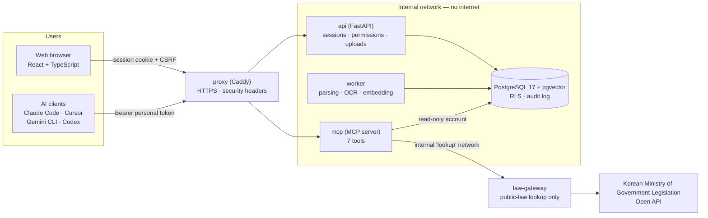
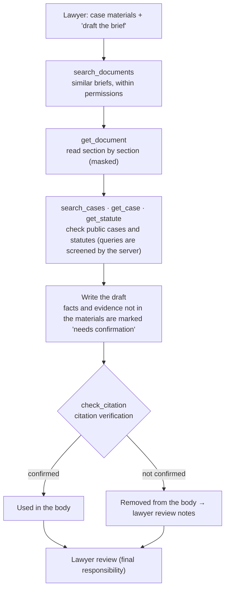
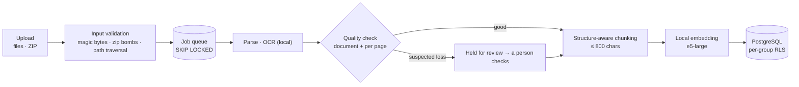

# lawca-mcp — An MCP server that helps AI agents draft legal briefs for a law firm

[한국어](README.md) · **English**

<table align="center">
<thead><tr><th>Item</th><th>Details</th></tr></thead>
<tbody>
<tr><td><b>Summary</b></td><td>An MCP server and web admin UI that lets AI agents <b>search and reference a firm's past briefs safely, within the user's permissions</b>, and draft briefs <b>without hallucinated citations</b></td></tr>
<tr><td><b>Period</b></td><td>2026-09-30 → ongoing (22 commits at the time of writing)</td></tr>
<tr><td><b>Role</b></td><td>Planning, design, backend, frontend, infrastructure and evaluation — solo, with an AI coding assistant</td></tr>
<tr><td><b>Size</b></td><td>~1,600 lines server · ~2,000 backend · ~2,000 frontend · ~730 DB · ~310 tests (184 backend · 58 MCP end-to-end · 36 container end-to-end · 36 unit)</td></tr>
<tr><td><b>Data</b></td><td><b>Entirely fictional dummy data</b> (32 matters · 71 briefs · 375 chunks). It has nothing to do with real people or cases. Output is a draft for a lawyer to review and is not legal advice.</td></tr>
</tbody>
</table>

---

## 1. Topic

* A system in which an AI agent (Claude Code, Cursor, Gemini CLI, Codex, …) **searches and reads a law firm's accumulated past briefs (complaints, answers, preparatory briefs) through MCP tools**, so that a single line — "draft the first preparatory brief for this case" — is enough to get a draft.

* There are seven tools: `list_matters`, `search_documents` and `get_document` for the firm's own documents; `check_citation` for citation verification; and `get_case` (case-law text), `get_statute` (current statute text) and `search_cases` (case-law search) for public legal sources. The web UI provides role-based login (admin / lawyer / clerk), bulk upload of briefs (files or ZIP), matter and access-group management, and personal tokens for connecting AI clients.

* The point is not to make the AI smarter. It is for the **server to control what the AI can access, what it can use, and what may leave the system**.

## 2. Planning Intent

* Legal material is among the most sensitive data there is, and AI invents plausible-looking case law and knows nothing about permissions. So instead of "asking the AI to follow rules", the goal was an architecture in which **the server and the database enforce the rules**.

| Risk | Response |
|---|---|
| Conflicts of interest between matters, read permissions | The **database's row-level security (RLS)**, not application code, enforces the scope of access; with no identity, nothing is visible (fail-closed). |
| Leakage of document contents | Embedding, OCR and search all run **locally**, and containers sit on an **internal network with no internet access**. |
| Personal data in text handed to the AI | The server **masks** text before it is returned (numbers, amounts, addresses, company names, parties, related persons). |
| Hallucinated case law and statutes | `check_citation` **verifies case numbers, decision dates and statute articles against the government Open API** and has the agent drop anything it cannot confirm from the body of the draft. |
| Users do not write long instructions | The rules live in the **server instructions and tool descriptions**, so a one-line request like "draft a brief" still follows them; this was checked with repeated runs. |

* The scope is deliberately narrow. The first task is the **preparatory brief**; calculation and billing tasks are out of scope; and what leaves the system is limited to one LLM call and one public-law lookup.

## 3. Architecture

### Overall layout

### How an agent drafts a brief

### How a brief gets into the database

### Core design principles

| Principle | Implementation |
|---|---|
| **The database enforces permissions** | A read-only account plus RLS. The app only sets the session variable `app.user_id`, and policies filter rows by the user's groups. A document outside the user's access gets the same "not found or no permission" answer, so even its existence stays hidden. |
| **What leaves is minimal and validated** | Only `law-gateway`, which can reach the internet, talks to the government API. It has no database access and accepts only validated case numbers, article numbers and screened search queries; it returns only the fields needed. |
| **Least-privilege database roles** | Owner / read-only / audit (write-only) / app / worker. Each container receives only the passwords it needs. |
| **Exact match for identifiers, vectors for meaning** | Case numbers, party names and amounts are filtered through dedicated arguments; free text combines document and chunk vectors with character trigrams using RRF (rank fusion). |
| **Failures are not left silent** | If parsing quality looks doubtful, the file is not indexed and goes to human review. The audit log is written so that a failed write also fails the call. |

## 4. Key Work & Outcomes

| Area | Details |
|---|---|
| **Hybrid search** | Embeddings that scored perfectly on 12 documents **could not find identifier queries (case numbers, amounts)** at 300 documents, so identifiers were split out into exact-match filters. Document vectors, chunk vectors and trigram keywords are combined with RRF, and structure-aware chunking (the five standard headings and sub-points) lets each result cite its section. A reranker cost 0.34–0.44 s per pair on CPU and some models made accuracy worse, so it was **tried and not adopted**. |
| **Permissions and authentication** | RLS and least-privilege roles enforce isolation between groups, verified through both the browser and the API. User identity first came from an environment variable, which can be forged, so it was replaced with **personal tokens issued from the web UI** (stored as hashes only, 7–90 day expiry, automatically revoked on password reset or deactivation, rate-limited, token ID recorded in the audit log). |
| **Masking** | Server-side rules mask numbers, amounts, addresses and company names; the parties and attorney from the matter database; **related persons registered per matter in the web UI**; and third-party names that come with a role word or honorific. Names are not guessed by an AI — only explainable, testable rules are used. On the 71 dummy briefs the new rules masked an extra 8 addresses and 12 names. The limitation (names without a role word are missed) is stated in every response. |
| **Citation verification** | When a model cites case law from memory it produces **convincing fakes**, complete with case number, date and holding (in a real run, one of two citations did not exist in the government database). `check_citation` checks the firm's registry and then the government API for existence, decision date, whether a cited paragraph exists and whether the statute is current, and warns when the holding the draft attributes to a case barely overlaps the official summary. A bug that reported real lower-court cases as "not found" because of a different case-number format was also found and fixed once the live service was connected. |
| **Public case-law and statute tools** | The government Open API is exposed as the MCP tools `get_case`, `get_statute` and `search_cases`. A search query is a sentence written by the AI and could carry case details outward, so there are **a tool description (legal terms only), a server-side screen (rejects numbers, amounts, addresses, company names and names, and returns the reason so the AI can rewrite), and an audit log**, with the screen applied in both the mcp server and the gateway. |
| **Parsing and OCR** | `kordoc` (with PP-OCRv5) converts HWP, HWPX, PDF, DOCX and scans locally. In an OCR comparison the current engine scored the highest on easy scans at **99.9%** (Tesseract 99.3%, EasyOCR 95.3%), but on hard scans it lost whole pages and scored 69.5% (Tesseract 93.2%). A **per-page quality check** was built to catch this **silent failure** (it flagged only the missing pages on synthetic scans). |
| **Handling ~20-page briefs** | The dummy briefs averaged about one page, so the real size (~20 pages) had never been tested. A synthetic 22-page brief exposed that long chunks overflowed the embedding input and were truncated, and that returning a whole document at once could exceed client limits. Chunks are now capped at 800 characters and `get_document` reads by `section` and `part`. |
| **Automated draft evaluation** | Short, user-style requests ("draft a brief") are run repeatedly through a headless agent and scored automatically on **12 required rules** — blank filing date, no asserted evidence content, no unverified citations, and so on. When case law was demanded, the agent still used only confirmed citations in the body (3 of 3). The sample is small, so it is not claimed to be stable. |
| **Web UI and operations** | A React UI (login, role-based menus, bulk upload, processing status, matters, related persons, AI connection, administration), a FastAPI backend, and six long-running containers (read-only filesystems, `cap_drop`, separated networks). The AI connection page gives copy-ready setup for Claude Code, Cursor, Gemini CLI and Codex. |
| **Tests and documentation** | 184 backend tests, 58 MCP end-to-end (stdio), 36 container end-to-end (token auth and live government lookups included) and 36 unit tests. 25 problems encountered are recorded as symptom → cause → fix → prevention. |

## 5. Tech Stack

| Category | Technology |
|---|---|
| **MCP / AI integration** | Python MCP SDK (streamable HTTP, stateless), connections for Claude Code · Cursor · Gemini CLI · Codex, headless-agent evaluation |
| **Search · embeddings** | PostgreSQL 17 + **pgvector**, pg_trgm, multilingual-e5-large (fastembed/ONNX, local), RRF fusion |
| **Document processing** | kordoc (Node; HWP/HWPX/PDF/DOCX conversion), PP-OCRv5 (built-in OCR), job queue (`SKIP LOCKED`) |
| **Backend** | Python 3.12, FastAPI, psycopg 3, server-side sessions + CSRF, scrypt, row-level security (RLS) |
| **Frontend** | React 19, TypeScript, Vite 7, react-router 7 |
| **Public data** | Korean National Law Information Open API (case law and statutes) |
| **Infra** | Docker Compose, Caddy (HTTPS, security headers), internal-only networks, non-root · read-only root · `cap_drop: ALL` |
| **QA** | pytest, end-to-end tests with a real MCP client, repeated draft evaluation (auto-scored), synthetic OCR comparison |

## 6. Troubleshooting

> All 25 entries are written up in [docs/트러블슈팅.md](docs/트러블슈팅.md) (Korean) as symptom → cause → fix → prevention. Below are the cases where **the problem and the improvement were confirmed by measurement**. All figures are from dummy data and synthetic inputs.

### Quantitative summary (Before → After)

| # | Problem | Metric | Before | After |
|---|---|---|---|---|
| 1 | Compound amounts (`2억 8,000만 원`) leaked through masking | Briefs with an amount fragment left | **16 / 71** | **0 / 71** (rules rewritten + 24 unit tests) |
| 2 | Embedding search collapsed at scale | hit@1 for case-number and party queries | **1.00** at 12 docs → **0.17 – 0.43** at 300 | Identifiers split out as exact-match filters (keyword-only **1.00** vs hybrid 0.77 on identifier queries); only semantic search stays hybrid |
| 3 | OCR spacing post-processing backfired | Spacing F1 vs keyword-search hits | F1 0.79 → **0.85 ↑**, but hits **11/12 → 5/12 ↓** | Not adopted; space-insensitive character n-gram keyword search instead |
| 4 | Adding a reranker | Topic hit@1 · case-number hit@1 · latency | bge 0.97 → **0.77 ↓** · jina case-number 1.00 → **0.43 ↓** · **7–9 s** per query | Not adopted (my time estimate was also off 4×: 0.08 s per pair assumed vs **0.34 s** measured, and corrected) |
| 5 | A ~20-page brief overflowed the embedding input | Tokens per chunk (limit 512) | A 1,197-char chunk = **662 tokens** (over); **1 of 62** chunks truncated on a synthetic 22-page brief | 800-char cap → max **467 tokens**, and number-dense text **428 tokens** (all ≤ 512) |
| 6 | OCR silently dropped pages | Accuracy on hard scans · missing pages | **69.5%** (Tesseract 93.2%); **3 of 10** pages recognised at only **3 / 6 / 14%** of their text, and the document-level check still passed | Per-page check caught **3/3** missing pages with **0/10** false alarms on easy scans (identical on Windows and in the container) |
| 7 | Case law cited from memory | Cited cases the government database could not confirm | **1 of 2 (50%)** did not exist | With citation verification: **3/3** agent runs that demanded case law used only confirmed citations in the body; **36/36** end-to-end tests including live lookups |
| 8 | Auto-scorer false positives and a test-setup bug | Pass rate of the brief evaluation | **2/6** (formatting differences scored as violations); the "without 04" run actually included file 04 | **5/6** after fixing the scorer, **6/6** after fixing the setup (it also revealed `check_citation` was called in only **9/12 = 75%** of runs) |

### Cases

- **A figure leaked even though masking "passed" (16/71 → 0/71)** 
  `보증금 2억 8,000만 원` ("deposit of 200 million 80 million won") was masked as `2억 [amount]`, exposing the first part to the agent. The earlier full-corpus check had passed because **it only looked for already-known failure shapes**. Compound amounts are now masked as a whole (the condition after `원` is restricted so words such as `원고`, `원본` and `원금` are untouched), and an independent check that also searches for leftover fragments plus 24 unit tests were added. The principle that followed: a check for "things that must not be present" has to look for pieces outside the known shapes too.

- **Conclusions that flipped as scale grew (search · OCR post-processing · reranker)** 
  Embeddings that scored a perfect hit@1 of 1.00 on 12 documents fell to 0.17–0.43 at 300, so identifiers were split out as exact matches. OCR spacing restoration raised its metric (F1) but split proper nouns and numbers, dropping real search hits from 11/12 to 5/12, and rerankers either lowered topic search from 0.97 to 0.77 or wrecked case-number queries (1.00 → 0.43) depending on the model. All three showed that **a metric can differ from the real goal and small-scale conclusions can reverse**, so each was judged on data and not adopted.

- **Test data did not represent real scale (662 tokens > 512)** 
  The dummy briefs averaged about one page (972 characters), so a real ~20-page brief had never been processed. A synthetic 22-page brief showed a 1,197-character chunk becoming 662 tokens, over the embedding model's input limit, so **its tail was never embedded**; returning a whole document could also exceed the client's response limit. The chunk cap went down to 800 characters (max 467 tokens), `section`/`part` reads were added, and regression tests pin both.

- **OCR silently dropped some pages (document-level check passed)** 
  On easy scans the current engine was the most accurate at 99.9%, but on hard scans (low resolution, skew, stamps) 3 of 10 pages came back with only 3%, 6% and 14% of their text, averaging 69.5%. The existing quality check looked only at the **whole document**, so such files passed. A per-page check that sends a file to review when a page has under 30% of the median page's text caught all 3 missing pages with no false alarms on 10 easy pages. Re-running the same engine on the page gave the same result (`--ocr-force`), so automatic recovery was deferred because it needs a dependency decision.

- **An integration tested only with mocks behaved differently on the live service** 
  The government API integration had been tested only with mocked responses. In reality, lower-court case numbers come back as `서울고등법원-2023-누-36796`, so a plain string comparison would have **reported real cases as "not found"**. Ten real responses were saved as fixtures and normalisation plus regression tests (41 tests across parsers, normalisation and query screening) were added — the first normaliser cut the `가단` prefix into `2024단…`, which the tests caught — and the response-shape pitfalls (a statute that is a list or a single object, a missing article that is a normal response rather than an error) were documented.

- **Scorer false positives and a test-setup bug (2/6 → 5/6 → 6/6)** 
  The first pass rate of 2/6 on the brief evaluation came from **scorer false positives** on formatting differences (bold or quoted headings), and the "without the statute file" scenario had a scenario-name bug that copied the file anyway. Both were found only by opening the outputs. The rule that followed: validate a scorer on known results right after writing it, and confirm from the output that the intended condition was actually applied.

## 7. Limitations and Next Steps

* **It has not been verified with real Hancom (HWP/HWPX) files, court forms or real scans.** The results are from synthetic data, and this is the first thing to check once real material is available.
* Masking cannot hide names that appear without a role word or addresses that give only a building name, and `check_citation` cannot guarantee that a holding is accurate (a lawyer must compare it with the source).
* Web-app connectors such as ChatGPT or claude.ai are not supported because they need a public server and OAuth, and clients other than Claude Code were configured from their public documentation but not actually connected.
* Next: broader evaluation of the new tools (an automatic check of search-query hygiene), a security review of the new external surface, operational documentation (backup, restore, incident response) and automatic OCR recovery.

## 8. Further Reading

| Document | Contents |
|---|---|
| [docs/실행가이드.md](docs/실행가이드.md) | Development and container setup, AI client connection, how to run the tests, known limitations (Korean) |
| [기획서_v2.md](기획서_v2.md) | Background, design decisions, task analysis and roadmap (Korean) |
| [docs/트러블슈팅.md](docs/트러블슈팅.md) | 25 problems with fixes and prevention, plus open problems (Korean) |
| [server/README.md](server/README.md) | The MCP server's tools, connection methods, authentication and masking (Korean) |
