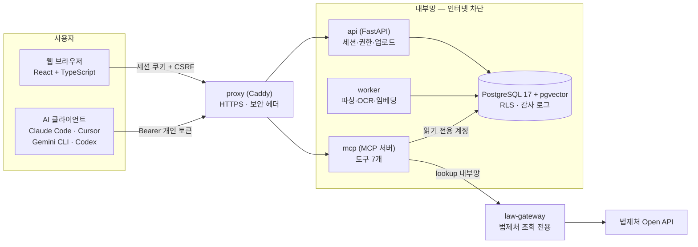
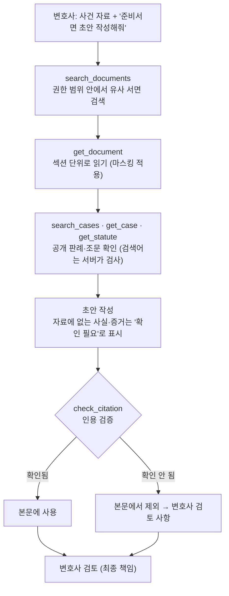
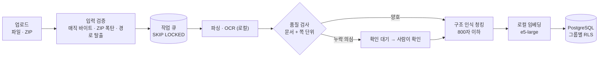

# lawca-mcp — 법무법인 서면 작성을 돕는 AI 에이전트용 MCP 서버

<table align="center">
<thead><tr><th>항목</th><th>내용</th></tr></thead>
<tbody>
<tr><td><b>한 줄 소개</b></td><td>사무소 내부의 과거 서면을 AI 에이전트가 <b>권한 범위 안에서 안전하게 검색·참고</b>하고, <b>환각 없이</b> 준비서면 초안을 쓰도록 돕는 MCP 서버와 웹 관리 화면</td></tr>
<tr><td><b>기간</b></td><td>2026-09-30 → 진행 중 (저장소 기준 커밋 22개)</td></tr>
<tr><td><b>역할</b></td><td>기획 · 설계 · 백엔드 · 프런트엔드 · 인프라 · 평가 전 과정 (1인, AI 코딩 도우미 활용)</td></tr>
<tr><td><b>규모</b></td><td>서버 약 1,600줄 · 백엔드 약 2,000줄 · 프런트엔드 약 2,000줄 · DB 약 730줄 · 시험 약 310개 (백엔드 184 · MCP 종단 58 · 컨테이너 종단 36 · 단위 36)</td></tr>
<tr><td><b>데이터</b></td><td><b>전부 가상의 더미</b> (사건 32건 · 서면 71건 · 청크 375개). 실제 사건·인물과 무관하며, 결과물은 변호사가 검토하는 초안이고 법률 자문이 아닙니다.</td></tr>
</tbody>
</table>

---

## 1. 주제 (Topic)

* 법무법인이 쌓아 둔 **과거 서면(소장·답변서·준비서면)을 AI 에이전트(Claude Code, Cursor, Gemini CLI, Codex 등)가 MCP 도구로 검색·조회**해 "이 사건의 제1차 준비서면 초안을 작성해줘" 한 줄로 초안을 쓰게 하는 시스템입니다.

* 도구는 7개입니다. 내부 자료용 `list_matters` · `search_documents` · `get_document`, 인용 검증용 `check_citation`, 공개 법령 조회용 `get_case`(판례 본문) · `get_statute`(현행 조문) · `search_cases`(판례 검색)입니다. 웹 화면에서는 역할(관리자/변호사/사무원)별 로그인, 서면 대량 업로드(파일·ZIP), 사건·접근 그룹 관리, AI 연결용 개인 토큰 발급을 제공합니다.

* 핵심은 AI를 똑똑하게 만드는 것이 아니라 **AI가 접근할 수 있는 것, 쓸 수 있는 것, 밖으로 내보낼 수 있는 것을 서버가 통제**하는 데 있습니다.

## 2. 기획 의도 (Planning Intent)

* 법무 자료는 가장 민감한 데이터이고, AI는 그럴듯한 판례를 지어내며 권한을 모릅니다. 그래서 "AI에게 규칙을 부탁한다"가 아니라 **규칙을 서버와 DB가 강제**하는 구조를 목표로 했습니다.

| 위험 | 대응 |
|---|---|
| 사건 간 이해충돌·열람 권한 | AI 코드가 아니라 **DB의 행 수준 보안(RLS)**이 접근 범위를 강제하고, 신원이 없으면 아무것도 보이지 않게(fail-closed) 했습니다. |
| 문서 원문의 외부 유출 | 임베딩·OCR·검색을 전부 **로컬**에서 하고, 컨테이너를 **인터넷이 막힌 내부망**에 두었습니다. |
| AI에게 넘기는 본문의 개인정보 | 서버가 **마스킹**한 텍스트만 넘깁니다(번호·금액·주소·상호·당사자·관련자 이름). |
| 판례·조문 환각 | `check_citation`이 사건번호·선고일·조문을 **법제처 공개 API로 대조**하고, 확인되지 않은 인용은 본문에서 빼게 합니다. |
| 사용자는 긴 지시문을 쓰지 않음 | "서면 초안 작성해줘" 한 줄만으로도 규칙이 지켜지도록 **서버 지침과 도구 설명**에 규칙을 넣고 반복 시험으로 확인했습니다. |

* 범위는 의도적으로 좁혔습니다. 첫 업무를 **준비서면**으로 정하고, 계산·청구 같은 업무는 제외했으며, 외부로 나가는 경계를 LLM 호출 하나와 법제처 조회 하나로 한정했습니다.

## 3. 아키텍처 (Architecture)

### 전체 구성

### 에이전트가 초안을 쓰는 흐름

### 서면이 DB에 들어가는 흐름

### 핵심 설계 원칙

| 원칙 | 구현 |
|---|---|
| **권한은 DB가 강제** | 읽기 전용 계정 + RLS. 앱은 세션 변수 `app.user_id`만 설정하고, 정책이 사용자 그룹 기준으로 행을 거릅니다. 권한 밖 문서는 "없거나 권한 없음"으로 같게 응답해 존재 자체를 숨깁니다. |
| **외부로 나가는 값은 최소·검증** | 법제처 조회는 인터넷에 나갈 수 있는 `law-gateway`만 하고, DB 접근이 없으며 검증된 사건번호·조문번호·검사 통과한 검색어만 받습니다. 응답도 필요한 필드만 돌려줍니다. |
| **최소 권한 DB 역할** | 소유자 / 읽기 전용 / 감사(쓰기만) / 앱 / 워커. 컨테이너마다 필요한 비밀번호만 받습니다. |
| **식별자는 정확 일치, 의미는 벡터** | 사건번호·당사자·금액은 전용 인자로 필터하고, 자연어는 문서·청크 벡터 + 글자 trigram을 RRF(순위 합성)로 결합합니다. |
| **실패를 조용히 두지 않음** | 파싱 품질이 의심되면 색인하지 않고 사람 확인 대기로 보냅니다. 감사 로그는 기록 실패 시 호출도 실패시킵니다. |

## 4. 주요 작업 및 성과 (Key Work & Outcomes)

| 항목 | 내용 |
|---|---|
| **하이브리드 검색** | 문서 12건에서 만점이던 임베딩이 300건에서는 **식별자 질의(사건번호·금액)를 못 찾는 것**을 확인하고, 식별자를 정확 일치 필터로 분리했습니다. 문서 벡터 + 청크 벡터 + trigram 키워드를 RRF로 결합하고 구조 인식 청킹(표준 5개 표제, 가·나·다 소절)으로 소절 단위 출처를 표기합니다. 리랭커는 쌍당 0.34~0.44초(CPU)에 일부 모델은 정확도가 오히려 떨어져 **실험 후 채택하지 않았습니다.** |
| **권한·인증** | RLS와 최소 권한 DB 역할로 그룹 간 격리를 강제하고 브라우저·API 양쪽에서 검증했습니다. 처음엔 환경변수로 사용자를 지정했으나 위조 가능해서 **웹에서 발급하는 개인 토큰**(해시만 저장, 7~90일 만료, 비밀번호 초기화·계정 비활성화 시 자동 폐기, 호출 속도 제한, 감사 로그에 토큰 ID 기록)으로 교체했습니다. |
| **마스킹** | 서버 측 규칙으로 번호·금액·주소·상호, 사건 DB의 당사자·변호사, 사건별 **관련자(웹에서 등록)**, 역할어·호칭이 붙은 제3자 이름을 가립니다. 이름은 AI로 추측하지 않고 설명·시험 가능한 규칙만 썼으며, 더미 71건에서 주소 8건·인명 12건을 추가로 가렸습니다. 역할어 없는 이름은 못 가리는 한계를 응답에 명시합니다. |
| **인용 검증** | 모델이 판례를 기억에 의존해 인용하면 사건번호·선고일·요지까지 갖춘 **그럴듯한 가짜**가 나옵니다(실제로 2건 중 1건이 법제처에 없었습니다). `check_citation`이 사무소 등록부 → 법제처 조회 순으로 대조해 존재·선고일·조문의 항·현행 여부를 확인하고, 서면이 쓴 판례 요지가 판시사항과 거의 겹치지 않으면 경고합니다. 하급심 사건번호 표기가 달라 실재 판례를 "없음"으로 판정하던 버그도 실서비스 연동에서 발견해 고쳤습니다. |
| **공개 판례·조문 도구** | 법제처 Open API를 우리 MCP의 `get_case` · `get_statute` · `search_cases`로 제공했습니다. 검색어는 AI가 만든 문장이라 사건 정보가 밖으로 나갈 수 있어, **도구 설명(법률 용어만) + 서버 검사(번호·금액·주소·상호·이름 거부, 이유를 돌려줘 AI가 재작성) + 감사 로그**를 함께 두고, 검사를 mcp와 중계 양쪽에 두었습니다. |
| **문서 파싱·OCR** | `kordoc`(+PP-OCRv5)으로 HWP·HWPX·PDF·DOCX와 스캔본을 로컬에서 변환합니다. OCR 비교 시험에서 현재 엔진은 쉬운 조건 정확도 **99.9%**(Tesseract 99.3%, EasyOCR 95.3%)로 가장 높았지만 어려운 조건에서는 일부 쪽의 글자가 통째로 사라져 69.5%(Tesseract 93.2%)였고, 이 **조용한 실패**를 잡는 **쪽 단위 품질 검사**를 만들었습니다(합성 스캔에서 누락 쪽만 정확히 검출). |
| **20쪽 규모 대응** | 시험 서면이 평균 1쪽이라 실제 규모(약 20쪽)를 검증한 적이 없다는 점을 발견해 합성 22쪽으로 시험했습니다. 긴 청크가 임베딩 입력 한도를 넘어 뒤가 잘리는 문제는 청크 한도 800자로, 문서를 통째로 반환하는 문제는 `section`·`part` 조회로 해결했습니다. |
| **서면 초안 평가 자동화** | "서면 초안 작성해줘" 같은 짧은 요청을 헤드리스 에이전트로 반복 실행하고, 제출일 비움·증거 내용 단정 금지·미확인 인용 없음 등 **12개 필수 규칙**을 자동 채점합니다. 판례를 요구하는 압박 요청에서도 확인된 인용만 본문에 쓰는 것을 확인했습니다(3/3). 표본이 작아 "안정적"이라 단정하지 않습니다. |
| **웹 화면·운영** | React 화면(로그인·역할별 메뉴·대량 업로드·처리 현황·사건·관련자·AI 연결·관리), FastAPI 백엔드, 6개 컨테이너 구성(읽기 전용 파일시스템·cap_drop·내부망 분리). AI 연결 화면은 Claude Code·Cursor·Gemini CLI·Codex 설정을 복사해서 쓰게 합니다. |
| **시험·문서** | 백엔드 184개, MCP 종단 58개(stdio), 컨테이너 종단 36개(토큰 인증·실제 법제처 조회 포함), 단위 36개. 겪은 문제 25건을 증상→원인→해결→재발 방지로 기록했습니다. |

## 5. 기술 스택 (Tech Stack)

| 분류 | 기술 |
|---|---|
| **MCP / AI 연동** | Python MCP SDK(streamable HTTP, stateless), Claude Code · Cursor · Gemini CLI · Codex 연결, 헤드리스 에이전트 평가 |
| **검색 · 임베딩** | PostgreSQL 17 + **pgvector**, pg_trgm, multilingual-e5-large(fastembed/ONNX, 로컬), RRF 결합 |
| **문서 처리** | kordoc(Node, HWP/HWPX/PDF/DOCX 변환), PP-OCRv5(내장 OCR), 작업 큐(`SKIP LOCKED`) |
| **Backend** | Python 3.12, FastAPI, psycopg 3, 서버 측 세션 + CSRF, scrypt, 행 수준 보안(RLS) |
| **Frontend** | React 19, TypeScript, Vite 7, react-router 7 |
| **공개 데이터** | 법제처 국가법령정보 공동활용 Open API(판례·법령) |
| **Infra** | Docker Compose, Caddy(HTTPS·보안 헤더), 내부 전용 네트워크, 비root·읽기 전용 루트·`cap_drop: ALL` |
| **QA** | pytest, 종단 시험(실제 MCP 클라이언트), 서면 초안 반복 시험(자동 채점), 합성 OCR 비교 시험 |

## 6. 트러블슈팅 (Troubleshooting)

> 전체 25건은 [docs/트러블슈팅.md](docs/트러블슈팅.md)에 증상 → 원인 → 해결 → 재발 방지로 정리했습니다. 아래는 대표 사례입니다.

- **마스킹이 "통과"했지만 새던 금액** 
  `보증금 2억 8,000만 원`이 `2억 [금액]`으로 마스킹돼 앞부분이 에이전트에 노출됐습니다. 문서 71건 전수 검사가 통과했는데 **검사 규칙이 이미 알려진 결함 모양만 봐서** 놓친 것이었습니다. 복합 금액 규칙을 새로 만들고 잔여 조각까지 찾는 독립 점검과 단위 시험을 추가했으며, "없어야 하는 것"을 검사할 때는 알려진 모양 밖의 조각도 찾아야 한다는 원칙을 세웠습니다.

- **시험 자료가 실제 규모를 대표하지 못함** 
  더미 서면이 평균 약 1쪽이라 실제 준비서면(약 20쪽)을 처리해 본 적이 없었습니다. 합성 22쪽으로 시험하니 청크 1,197자가 662토큰이 되어 임베딩 입력 한도(512)를 넘어 **뒤쪽이 벡터에 반영되지 않았고**, 문서를 통째로 돌려주면 AI 쪽 응답 한도에 걸릴 수 있었습니다. 청크 한도를 800자로 낮추고 `section`·`part` 조회를 추가했으며 회귀 시험으로 고정했습니다.

- **OCR이 일부 쪽을 조용히 놓침** 
  현재 엔진은 쉬운 스캔에서 가장 정확했지만, 어려운 스캔(저해상도·기울기·도장)에서 일부 쪽의 글자가 3~14%만 인식됐습니다. 기존 품질 검사는 **문서 전체**의 글자 수만 봐서 20쪽 중 3쪽이 비어도 통과했습니다. 쪽별 글자 수가 중앙값의 30% 미만이면 "확인 대기"로 보내는 쪽 단위 검사를 만들어 합성 데이터에서 누락 쪽만 정확히 잡았습니다(윈도우·컨테이너 동일). 자동 복구는 의존성 판단이 필요해 보류했습니다.

- **모의 응답으로만 시험한 연동이 실서비스에서 다르게 동작** 
  법제처 연동을 모의 응답으로만 시험했는데, 실제로는 하급심 사건번호가 `서울고등법원-2023-누-36796`처럼 돌아와 문자열 비교로는 **실재 판례를 "없음"으로 오판정**했습니다. 실제 응답을 시험 자료로 저장해 정규화와 회귀 시험을 만들었고(첫 정규화도 `가단` 부호를 잘라 시험이 잡았습니다), 응답 구조의 함정(조문이 리스트 또는 단일 객체, 없는 조문은 오류가 아닌 정상 응답)도 문서화했습니다.

- **자동 채점기의 오탐과 시험 조건 버그** 
  서면 초안 시험의 첫 통과율(2/6)이 서식 차이(굵은 글씨·인용문 표제)를 위반으로 잡은 **채점기 오탐** 때문이었고, "04번 파일 없음" 시나리오에는 파일이 그대로 복사되는 **시나리오 이름 버그**가 있었습니다. 결과를 열어 원문을 확인하고서야 발견했고, 채점기는 만든 직후 이미 아는 결과에 돌려 검증하고 조건이 실제로 적용됐는지 결과물에서 확인하는 것을 원칙으로 삼았습니다.

- **MCP 사용자 신원이 위조 가능** 
  초기에는 서버를 띄우는 프로세스의 환경변수(`LAWCA_USER_ID`)가 사용자 신원이라 마음대로 정할 수 있었습니다. 웹에서 변호사가 발급하는 개인 토큰(해시만 저장, 만료·폐기, 요청마다 검증)으로 교체하고, HTTP 모드에서는 환경변수 신원을 아예 쓰지 않게 했으며, 신원 위조 헤더가 무시되는 것까지 시험으로 확인했습니다.

- **파싱 뒤 락을 풀어 같은 문서를 두 워커가 중복 색인** 
  파싱 단계와 색인 단계 사이에 작업 락이 풀려 두 워커가 같은 문서를 집을 수 있었습니다. 락을 유지한 채 색인 단계로 넘기게 고치고, 그룹이 다른 업로드의 파일 경로가 공유돼 한 그룹의 삭제가 다른 그룹의 원본을 지울 수 있던 문제도 그룹별 경로로 분리했습니다.

## 7. 한계와 다음 단계

* **실제 한컴(HWP/HWPX)·법원 서식·실제 스캔본으로는 검증하지 못했습니다.** 합성 데이터에서의 결과이며, 실제 자료를 구하면 가장 먼저 확인할 항목입니다.
* 마스킹은 역할어 없는 제3자 이름과 건물명만 있는 주소를 가리지 못하고, `check_citation`은 판시 요지의 정확성까지는 보증하지 못합니다(변호사가 원문 대조).
* ChatGPT·claude.ai 같은 웹 앱 커넥터는 서버 공개와 OAuth가 필요해 지원하지 않고, Claude Code 외 클라이언트는 설정을 문서 기준으로 작성했을 뿐 실제 연결은 확인하지 못했습니다.
* 다음 단계: 새 도구에 대한 평가 확대(검색어 위생 자동 검사), 외부 연결면 보안 점검, 운영 문서화(백업·복구·장애 대응), 스캔 OCR 자동 복구.

## 8. 더 보기

| 문서 | 내용 |
|---|---|
| [docs/실행가이드.md](docs/실행가이드.md) | 개발·컨테이너 실행, AI 연결, 시험 방법, 알려진 한계 |
| [기획서_v2.md](기획서_v2.md) | 기획 배경과 설계 결정, 업무 분석, 로드맵 |
| [docs/트러블슈팅.md](docs/트러블슈팅.md) | 겪은 문제 25건과 해결·재발 방지, 열린 문제 |
| [server/README.md](server/README.md) | MCP 서버 도구 설명, 접속 방식, 인증·마스킹 구조 |
