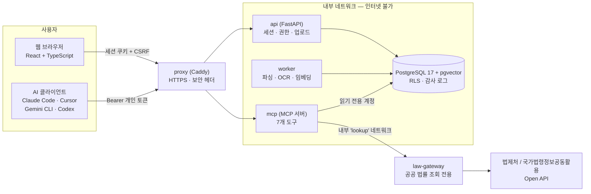
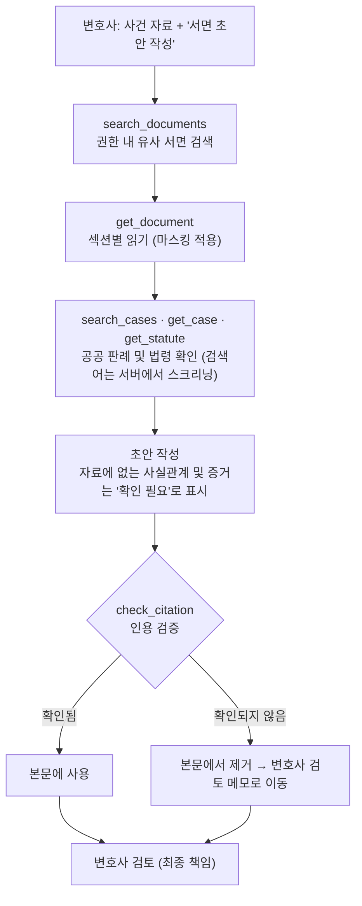
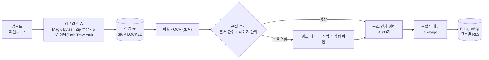

# lawca-mcp — 법률사무소의 AI 에이전트가 서면(준비서면) 작성을 돕는 MCP 서버

**한국어** · [English](README.en.md)

<table align="center">
<thead><tr><th>항목</th><th>내용</th></tr></thead>
<tbody>
<tr><td><b>한 줄 소개</b></td><td>사무소 내부의 과거 서면을 AI 에이전트가 <b>권한 범위 안에서 안전하게 검색·참고</b>하고, <b>환각 없이</b> 준비서면 초안을 쓰도록 돕는 MCP 서버와 웹 관리 화면</td></tr>
<tr><td><b>기간</b></td><td>2026-09-30 → 진행 중 (작성 시점 기준 커밋 22개)</td></tr>
<tr><td><b>역할</b></td><td>기획 · 설계 · 백엔드 · 프런트엔드 · 인프라 · 평가 전 과정 (1인, AI 코딩 도우미 활용)</td></tr>
<tr><td><b>규모</b></td><td>서버 약 1,600줄 · 백엔드 약 2,000줄 · 프런트엔드 약 2,000줄 · DB 약 730줄 · 시험 약 310개 (백엔드 184 · MCP 종단 58 · 컨테이너 종단 36 · 단위 36)</td></tr>
<tr><td><b>데이터</b></td><td><b>전부 가상의 더미</b> (사건 32건 · 서면 71건 · 청크 375개). 실제 인물·사건과 무관하며, 결과물은 변호사가 검토하는 초안이고 법률 자문이 아닙니다.</td></tr>
</tbody>
</table>

---

## 1. 주제

* AI 에이전트(Claude Code, Cursor, Gemini CLI, Codex 등)가 **MCP 도구를 통해 법률사무소에 축적된 과거 서면(소장, 답변서, 준비서면)을 검색하고 읽어**, "이 사건의 1차 준비서면 초안 작성해줘"라는 단 한 줄의 요청으로도 초안을 얻을 수 있도록 하는 시스템입니다.
* 7개의 도구를 제공합니다. 사무소 내부 문서용 `list_matters`, `search_documents`, `get_document`, 인용 검증용 `check_citation`, 공공 법률 정보용 `get_case`(판례 전문), `get_statute`(현행 법령 전문), `search_cases`(판례 검색)입니다. 웹 UI는 역할 기반 로그인(관리자 / 변호사 / 사무장), 서면 일괄 업로드(파일 또는 ZIP), 사건 및 접근 그룹 관리, AI 클라이언트 연결용 개인 토큰 기능을 제공합니다.
* 핵심은 AI를 더 똑똑하게 만드는 것이 아닙니다. **AI가 무엇에 접근할 수 있고, 무엇을 사용할 수 있으며, 무엇이 시스템 외부로 나갈 수 있는지 서버가 제어**하는 것입니다.

## 2. 기획 의도

* 법률 자료는 가장 민감한 데이터 중 하나이며, AI는 그럴듯한 거짓 판례를 만들어내고 권한 개념을 전혀 모릅니다. 따라서 "AI에게 규칙을 따르도록 요청"하는 대신, **서버와 데이터베이스가 규칙을 강제**하는 아키텍처를 목표로 했습니다.

| 위험 요소 | 대응 방안 |
| --- | --- |
| 사건 간 이해상충, 읽기 권한 문제 | 애플리케이션 코드가 아닌 **데이터베이스의 행 수준 보안(RLS)**이 접근 범위를 강제하며, 식별 정보가 없으면 아무것도 보이지 않습니다(Fail-closed). |
| 문서 내용 유출 | 임베딩, OCR, 검색이 모두 **로컬**에서 실행되며, 컨테이너는 **인터넷 연결이 없는 내부 네트워크**에 위치합니다. |
| AI에 전달되는 텍스트 내 개인정보 | 서버가 텍스트를 반환하기 전에 **마스킹**(전화번호, 금액, 주소, 회사명, 당사자, 관계인)을 수행합니다. |
| 환각된 판례 및 법령 인용 | `check_citation`이 **정부 Open API를 통해 사건번호, 선고일자, 법령 조문을 검증**하며, 에이전트가 확인하지 못한 내용은 본문에서 제외하도록 합니다. |
| 사용자가 긴 지시사항을 작성하지 않음 | 규칙이 **서버 지시문과 도구 설명**에 포함되어 있어, "서면 작성해줘"와 같은 한 줄 요청도 규칙을 준수합니다(반복 실행을 통해 검증됨). |

* 범위는 의도적으로 좁혔습니다. 첫 번째 타겟 과제는 **준비서면**이며, 계산 및 청구 작업은 범위에서 제외됩니다. 시스템 외부로 나가는 정보는 단 1회의 LLM 호출과 1회의 공공 법률 조회로 제한됩니다.

## 3. 아키텍처

### 전체 구조

### 에이전트의 서면 작성 프로세스

### 서면의 데이터베이스 저장 프로세스

### 핵심 설계 원칙

| 원칙 | 구현 내용 |
| --- | --- |
| **데이터베이스가 권한 강제** | 읽기 전용 계정과 RLS를 조합합니다. 앱은 세션 변수 `app.user_id`만 설정하며, 정책이 사용자의 그룹에 따라 행을 필터링합니다. 권한이 없는 문서는 "찾을 수 없거나 권한이 없음"으로 처리되어 존재 자체도 숨겨집니다. |
| **외부 유출 최소화 및 검증** | 인터넷에 접근할 수 있는 `law-gateway`만이 정부 API와 통신합니다. DB 접근 권한이 없으며 검증된 사건번호, 조문 번호, 스크리닝된 검색어만 수용하고 필요한 필드만 반환합니다. |
| **최소 권한 DB 역할** | Owner / Read-only / Audit(기록 전용) / App / Worker로 분리됩니다. 각 컨테이너는 필요한 패스워드만 전달받습니다. |
| **식별자는 정확히 일치, 의미는 벡터로** | 사건번호, 당사자명, 금액은 전용 인자 필터링을 거치며, 자유 텍스트는 RRF(Rank Fusion)를 통해 문서 및 청크 벡터와 문자 3글자(Trigram)를 결합합니다. |
| **실패를 묵인하지 않음** | 파싱 품질이 의심스러우면 문서를 인덱싱하지 않고 사람의 검토 단계로 보냅니다. 감사 로그는 쓰기 실패 시 전체 호출이 실패하도록 작성됩니다. |

## 4. 주요 작업 내용 및 성과

| 분야 | 상세 내용 |
| --- | --- |
| **하이브리드 검색** | 12개 문서에서 완벽했던 임베딩이 300개 문서에서는 **식별자 쿼리(사건번호, 금액 등)**를 찾지 못하여, 식별자를 정확히 일치하는 필터로 분리했습니다. 문서 벡터, 청크 벡터, Trigram 키워드를 RRF로 결합하였고, 구조 인지 청킹(5개 표준 목차 및 하위 항목)을 통해 각 결과가 해당 섹션을 인용할 수 있게 했습니다. 리랭커(Reranker)는 CPU 환경에서 쌍당 0.34~0.44초가 소요되고 일부 모델은 정확도를 떨어뜨려 **실험 후 채택하지 않았습니다**. |
| **권한 및 인증** | RLS와 최소 권한 역할을 통해 그룹 간 격리를 강제하며, 브라우저와 API 모두에서 검증했습니다. 사용자 식별에 위조 가능한 환경 변수를 사용하던 방식을 **웹 UI에서 발급하는 개인 토큰**으로 교체했습니다 (해시로만 저장, 7~90일 유효기간, 비밀번호 변경/계정 비활성화 시 자동 취소, 요청 제한 적용, 감사 로그에 토큰 ID 기록). |
| **마스킹** | 서버 측 규칙으로 전화번호, 금액, 주소, 회사명을 마스킹합니다. 사건 DB의 당사자 및 대리인, **웹 UI에서 사건별로 등록된 관계인**, 역할어나 호칭이 붙은 제3자 이름을 처리합니다. 이름 추정에 AI를 사용하지 않고 설명 가능하고 테스트 가능한 규칙만 사용합니다. 71개의 더미 서면에서 새 규칙을 적용해 8개의 주소와 12개의 이름을 추가로 마스킹했습니다. 한계점(역할어가 없는 이름은 누락됨)은 모든 응답에 명시됩니다. |
| **인용 검증** | 모델이 기억에 의존해 판례를 인용할 경우 사건번호, 선고일자, 요지까지 갖춘 **그럴듯한 가짜**를 생성합니다 (실제 실행 시 2개 인용 중 1개가 정부 DB에 존재하지 않음). `check_citation`은 자체 등록부와 정부 API를 통해 존재 여부, 선고일자, 인용 단락 존재 여부, 법령의 현행 여부를 검증하며, 초안이 주장하는 요지와 공식 요약문 간의 유사도가 낮을 경우 경고를 표시합니다. 실제 서비스 연결 후 사건번호 형식이 달라 하급심 판례를 "찾을 수 없음"으로 잘못 보고하던 버그도 수정했습니다. |
| **공공 판례 및 법령 도구** | 정부 Open API를 MCP 도구인 `get_case`, `get_statute`, `search_cases`로 제공합니다. 검색어는 AI가 작성한 문장이므로 외부로 사건 상세 내용이 유출될 수 있어, **도구 설명(법률 용어만 사용하도록 지정), 서버 측 스크리닝(숫자, 금액, 주소, 회사명, 이름 차단 및 재작성 사유 반환), 감사 로그**를 적용했으며, 스크리닝은 mcp 서버와 게이트웨이 모두에 적용됩니다. |
| **파싱 및 OCR** | `kordoc`(PP-OCRv5 탑재)을 사용해 HWP, HWPX, PDF, DOCX 및 스캔본을 로컬에서 변환합니다. OCR 비교 테스트 결과, 현재 엔진이 선명한 스캔본에서 **99.9%**로 가장 높은 점수를 기록했으나 (Tesseract 99.3%, EasyOCR 95.3%), 손상된 스캔본에서는 전체 페이지가 누락되며 69.5%를 기록했습니다 (Tesseract 93.2%). 이러한 **감춰진 오류(silent failure)**를 감지하기 위해 **페이지별 품질 검사** 기능을 구현했습니다. |
| **약 20페이지 서면 처리** | 더미 서면은 평균 1페이지 분량이었기에 실제 규모(~20페이지)에 대한 검증이 부족했습니다. 가상의 22페이지 서면 테스트 결과, 긴 청크가 임베딩 입력 제한을 초과해 잘리는 현상과 전체 문서를 한 번에 반환할 때 클라이언트 제한을 초과하는 문제를 확인했습니다. 현재는 청크 크기를 800자로 제한하고 `get_document`가 `section` 및 `part` 단위로 읽도록 개선했습니다. |
| **자동화된 초안 평가** | "서면 작성해줘"와 같은 짧은 사용자 스타일의 요청을 무헤드(Headless) 에이전트로 반복 실행하고, **12가지 필수 규칙**(제출 일자 비워두기, 입증되지 않은 증거 내용 작성 금지, 검증되지 않은 인용 금지 등)에 대해 자동 평가합니다. 판례 인용을 요구했을 때도 에이전트는 확인된 인용문만 본문에 사용했습니다 (3/3회). 샘플 수가 적어 결과가 완전히 안정적이라고 단정할 수는 없습니다. |
| **웹 UI 및 운영** | React UI(로그인, 역할 기반 메뉴, 일괄 업로드, 처리 상태, 사건, 관계인, AI 연결, 관리자 기능), FastAPI 백엔드, 6개의 장기 실행 컨테이너(읽기 전용 파일시스템, `cap_drop`, 분리된 네트워크)로 구성됩니다. AI 연결 페이지는 Claude Code, Cursor, Gemini CLI, Codex용 설정값을 즉시 복사할 수 있도록 제공합니다. |
| **테스트 및 문서화** | 백엔드 테스트 184개, MCP E2E 58개(stdio), 컨테이너 E2E 36개(토큰 인증 및 실제 정부 조회 포함), 단단위 테스트 36개를 작성했습니다. 발생했던 25가지 문제는 현상 → 원인 → 해결 → 예방 형태로 기록되었습니다. |

## 5. 기술 스택

| 분류 | 기술 |
| --- | --- |
| **MCP / AI 연동** | Python MCP SDK (스트리밍 HTTP, 상태 없음), Claude Code · Cursor · Gemini CLI · Codex 연동, 무헤드 에이전트 평가 |
| **검색 · 임베딩** | PostgreSQL 17 + **pgvector**, pg_trgm, multilingual-e5-large (fastembed/ONNX, 로컬), RRF 결합 |
| **문서 처리** | kordoc (Node 기반; HWP/HWPX/PDF/DOCX 변환), PP-OCRv5 (내장 OCR), 작업 큐 (`SKIP LOCKED`) |
| **백엔드** | Python 3.12, FastAPI, psycopg 3, 서버 측 세션 + CSRF, scrypt, 행 수준 보안 (RLS) |
| **프론트엔드** | React 19, TypeScript, Vite 7, react-router 7 |
| **공공 데이터** | 국가법령정보공동활용 Open API (판례 및 법령) |
| **인프라** | Docker Compose, Caddy (HTTPS, 보안 헤더), 내부 전용 네트워크, Non-root · Read-only Root · `cap_drop: ALL` |
| **품질 보증 (QA)** | pytest, 실제 MCP 클라이언트를 이용한 E2E 테스트, 반복적 초안 평가(자동 점수산정), 합성 OCR 비교 |

## 6. 트러블슈팅

> 25가지 전체 항목은 [docs/트러블슈팅.md](docs/트러블슈팅.md)에 현상 → 원인 → 해결 → 예방 구조로 정리되어 있습니다. 아래는 **측정을 통해 문제와 개선 효과가 확인된 사례**들입니다. 모든 수치는 더미 데이터 및 합성 입력을 기준으로 합니다.

### 정량적 요약 (전 → 후)

| # | 문제 상황 | 측정 지표 | 적용 전 | 적용 후 |
| --- | --- | --- | --- | --- |
| 1 | 복합 금액 단어(`2억 8,000만 원`) 마스킹 누락 | 금액 조각이 남은 서면 수 | **16 / 71** | **0 / 71** (규칙 재작성 + 단단위 테스트 24개 추가) |
| 2 | 규모 확장 시 임베딩 검색 성능 저하 | 사건번호 및 당사자 쿼리의 hit@1 | 12개 문서에서 **1.00** → 300개에서 **0.17 – 0.43** | 식별자를 정확 일치 필터로 분리 (식별자 쿼리 기준 키워드 전용 **1.00** vs 하이브리드 0.77); 의미 검색만 하이브리드로 유지 |
| 3 | OCR 띄어쓰기 후처리의 역효과 | 띄어쓰기 F1 vs 키워드 검색 적중 | F1 0.79 → **0.85 ↑**, 그러나 적중 수 **11/12 → 5/12 ↓** | 미채택; 대신 띄어쓰기에 유연한 문자 n-gram 키워드 검색 적용 |
| 4 | 리랭커(Reranker) 도입 | 주제 hit@1 · 사건번호 hit@1 · 지연 시간 | bge 0.97 → **0.77 ↓** · jina 사건번호 1.00 → **0.43 ↓** · 쿼리당 **7–9초** | 미채택 (예상 시간도 4배 오차 발생: 쌍당 0.08초 예상 vs **0.34초** 실제 측정되어 수정) |
| 5 | ~20페이지 서면의 임베딩 입력 초과 | 청크당 토큰 수 (제한: 512) | 1,197자 청크 = **662 토큰** (초과); 22페이지 합성 서면에서 **62개 중 1개** 청크 잘림 | 800자 제한 적용 → 최대 **467 토큰**, 숫자 밀집 텍스트 **428 토큰** (모두 ≤ 512) |
| 6 | OCR의 페이지 누락 현상 (Silent Failure) | 손상된 스캔본 정확도 · 누락 페이지 | **69.5%** (Tesseract 93.2%); 10페이지 중 **3페이지**의 텍스트가 **3 / 6 / 14%**만 인식되었으나 문서 단위 검사 통과 | 페이지별 검사 도입으로 선명한 스캔본 10장 중 오탐 0건으로 누락 페이지 **3/3개** 감지 (Windows 및 컨테이너 동일) |
| 7 | 기억에 의존한 판례 인용 | 정부 DB에서 확인되지 않는 인용 판례 | **2개 중 1개 (50%)** 존재하지 않음 | 인용 검증 도입 후: 판례를 요구한 에이전트 실행 **3/3회** 모두 확인된 인용만 본문에 사용; 실제 조회를 포함한 E2E 테스트 **36/36개** 통과 |
| 8 | 자동 평가 도구의 오탐 및 테스트 설정 버그 | 서면 평가 통과율 | **2/6** (서식 차이를 위반으로 처리); "04 파일 제외" 실행 시 실제로는 04 파일이 포함됨 | 평가 도구 수정 후 **5/6**, 설정 수정 후 **6/6** (과정에서 `check_citation` 호출 비율이 **9/12 = 75%**에 불과했음을 발견) |

### 대표 사례

* **마스킹 테스트를 통과했으나 숫자가 유출됨 (16/71 → 0/71)**

`보증금 2억 8,000만 원`이 `2억 [amount]`로 마스킹되어 앞부분이 에이전트에 노출되었습니다. 이전 전체 코퍼스 검사는 **이미 알려진 오류 패턴만 확인했기 때문**에 이 문제가 통과되었습니다. 복합 금액 전체를 마스킹하도록 변경하고(`원` 뒤의 조건을 제한하여 `원고`, `원본`, `원금` 등의 단어가 영향받지 않도록 조치), 남은 조각을 찾는 독립적인 검사 및 24개의 단단위 테스트를 추가했습니다. 이에 따른 원칙: "존재해서는 안 되는 항목"에 대한 검사는 알려진 패턴 이외의 요소도 함께 탐색해야 합니다.
* **규모가 커짐에 따라 뒤집힌 결론 (검색 · OCR 후처리 · 리랭커)**

12개 문서에서 1.00의 완전한 hit@1을 기록했던 임베딩 성능이 300개 문서에서는 0.17~0.43으로 떨어져, 식별자 검색을 정확 일치 방식으로 분리했습니다. OCR 띄어쓰기 복원은 지표(F1)는 올렸으나 고유명사와 숫자를 분리시켜 실제 검색 적중률을 11/12에서 5/12로 떨어뜨렸습니다. 리랭커 역시 모델에 따라 주제 검색 정밀도를 0.97에서 0.77로 낮추거나 사건번호 쿼리를 망가뜨렸습니다(1.00 → 0.43). 세 가지 사례 모두 **지표가 실제 목적과 다를 수 있으며 소규모에서의 결론이 뒤집힐 수 있음**을 보여주었기에, 실제 데이터를 바탕으로 판단하여 채택하지 않았습니다.
* **실제 규모를 반영하지 못했던 테스트 데이터 (662 토큰 > 512)**

더미 서면은 평균 1페이지(972자) 분량이어서 실제 크기(~20페이지)에 대한 처리가 테스트되지 않았습니다. 가상의 22페이지 서면을 테스트한 결과, 1,197자 청크가 662토큰으로 변환되어 임베딩 모델의 입력 제한을 초과함에 따라 **뒷부분이 임베딩되지 않는 문제**가 발생했습니다. 또한 전체 문서를 반환할 때 클라이언트의 응답 제한을 초과할 위험도 있었습니다. 이에 청크 제한을 800자로 낮추고(최대 467토큰), `section`/`part` 단위 읽기 기능을 추가하였으며 이를 회귀 테스트로 고정했습니다.
* **OCR의 일부 페이지 누락 (문서 단위 검사 통과)**

선명한 스캔본에서 현재 엔진은 99.9%로 가장 높은 정확도를 보였으나, 손상된 스캔본(저해상도, 기울어짐, 도장 등)에서는 10페이지 중 3페이지가 각각 3%, 6%, 14%의 텍스트만 인식되어 평균 69.5%에 그쳤습니다. 기존 품질 검사는 **전체 문서 단위**만 확인했기 때문에 이런 파일들이 검사를 통과했습니다. 중간값 페이지 텍스트의 30% 미만인 페이지가 있을 때 검토 대기로 전환하는 페이지별 검사를 도입하여, 선명한 10페이지 기준 오탐 없이 누락된 3페이지를 모두 잡아냈습니다. 해당 페이지에 동일 엔진을 재실행해도 결과가 동일했기에(`--ocr-force`), 자동 복구 기능은 의존성 결정이 필요하여 우선 순위를 미루었습니다.
* **Mock으로만 테스트된 연동 모듈이 실제 서비스에서 다르게 동작함**

정부 API 연동은 가상 응답(Mock)으로만 테스트되었습니다. 그러나 실제 하급심 사건번호는 `서울고등법원-2023-누-36796` 형태로 반환되어, 단순 문자열 비교 시 **실제 존재하는 사건을 "찾을 수 없음"으로 처리하는 문제**가 발생했습니다. 10개의 실제 응답을 픽스처(Fixture)로 저장하고 정규화 및 회귀 테스트(파서, 정규화, 쿼리 스크리닝에 걸쳐 41개 테스트)를 추가했습니다. 이 과정에서 초기 정규화 로직이 `가단` 접두사를 `2024단…`으로 잘못 자르는 문제를 테스트로 잡아냈으며, 응답 형태의 예외 케이스(단일 객체 또는 리스트 형태로 오는 법령 데이터, 조문 누락 시 에러가 아닌 정상 응답 처리 등)를 문서화했습니다.
* **평가 도구 오탐 및 테스트 설정 버그 (2/6 → 5/6 → 6/6)**

서면 평가의 초기 통과율이 2/6에 불과했던 이유는 서식 차이(볼드체 또는 따옴표 형태의 제목)를 위반으로 판단한 **평가 도구의 오탐**과, "법령 파일 없음" 시나리오에서 이름 버그로 인해 파일이 그대로 복사되었던 문제 때문이었습니다. 두 문제 모두 결과 출력물을 직접 열어본 후에야 발견되었습니다. 정립된 원칙: 평가 도구를 작성한 직후 이미 알고 있는 결과를 통해 검증하고, 의도한 조건이 실제로 적용되었는지 출력물을 통해 확인해야 합니다.

## 7. 한계점 및 향후 계획

* **실제 한글(HWP/HWPX) 파일, 법원 양식, 실제 스캔본을 통한 검증은 아직 이루어지지 않았습니다.** 현재 결과는 합성 데이터 기준이며, 실제 자료가 확보되는 대로 가장 먼저 검증할 예정입니다.
* 마스킹 기능은 역할어 없이 단독으로 등장하는 이름이나 건물명만 기재된 주소를 숨기지 못하며, `check_citation`이 판시사항의 완전한 정확성까지 보장하지는 못합니다 (변호사가 원문과 직접 비교해야 함).
* ChatGPT나 claude.ai와 같은 웹 앱 커넥터는 공개 서버 및 OAuth가 필요하므로 지원하지 않으며, Claude Code 이외의 클라이언트는 공개 문서를 바탕으로 설정만 작성되었고 실제 연결 검증은 거치지 않았습니다.
* 향후 계획: 새 도구들에 대한 광범위한 평가(검색 쿼리 건전성 자동 검사), 외부 노출 면에 대한 보안 검토, 운영 문서화(백업, 복구, 장애 대응), OCR 자동 복구 기능 구현.

## 8. 추가 참고 문서

| 문서 | 내용 |
| --- | --- |
| [docs/실행가이드.md](docs/실행가이드.md) | 개발 및 컨테이너 환경 설정, AI 클라이언트 연결 방법, 테스트 실행 방법, 알려진 한계점 (한국어) |
| [기획서_v2.md](기획서_v2.md) | 추진 배경, 설계 의도, 과제 분석 및 로드맵 (한국어) |
| [docs/트러블슈팅.md](docs/트러블슈팅.md) | 해결책과 예방법이 포함된 25가지 문제 항목 및 미해결 과제 (한국어) |
| [server/README.md](server/README.md) | MCP 서버의 도구, 연결 방법, 인증 및 마스킹 설명 (한국어) |